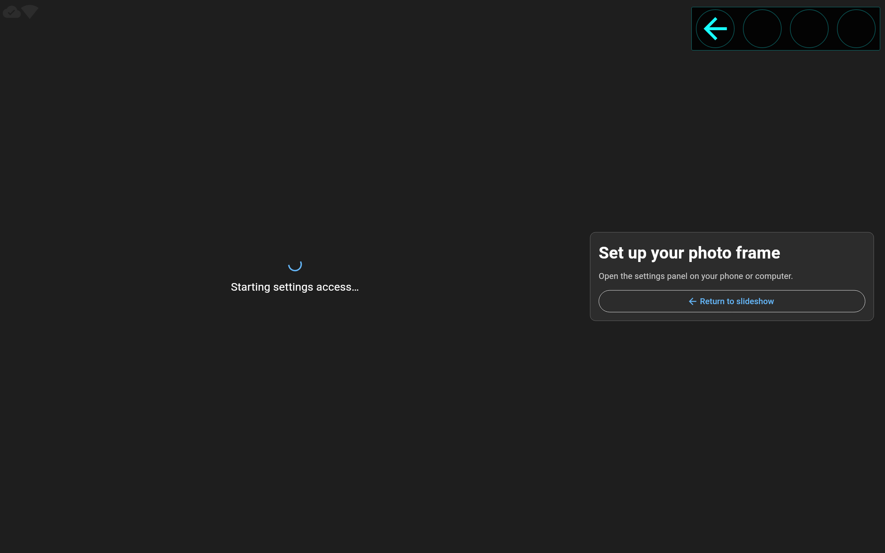
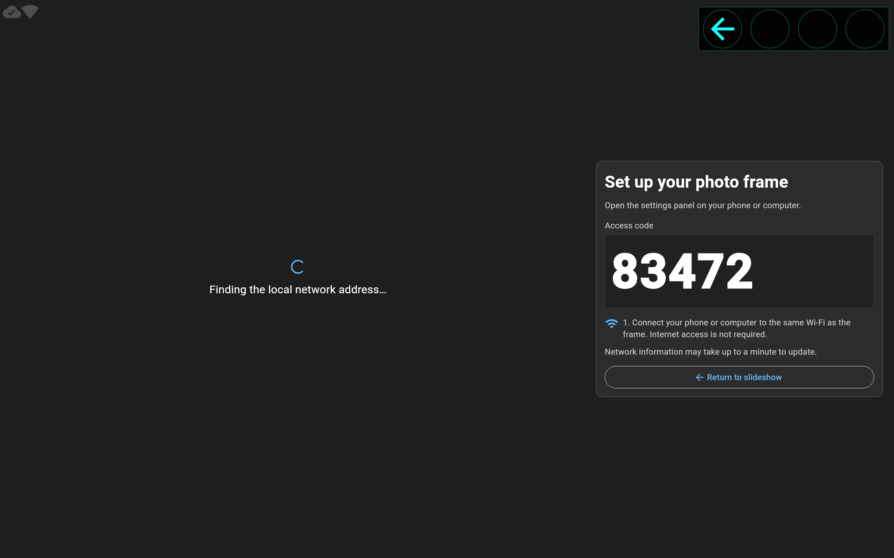
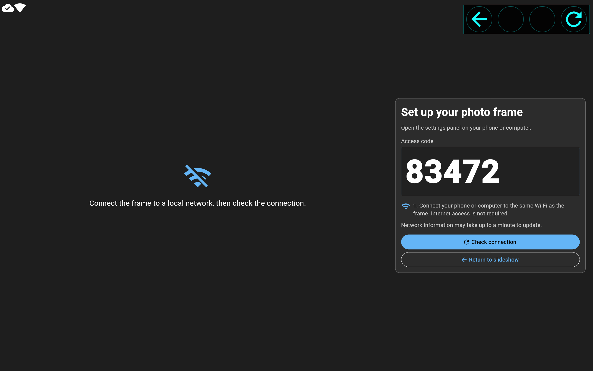
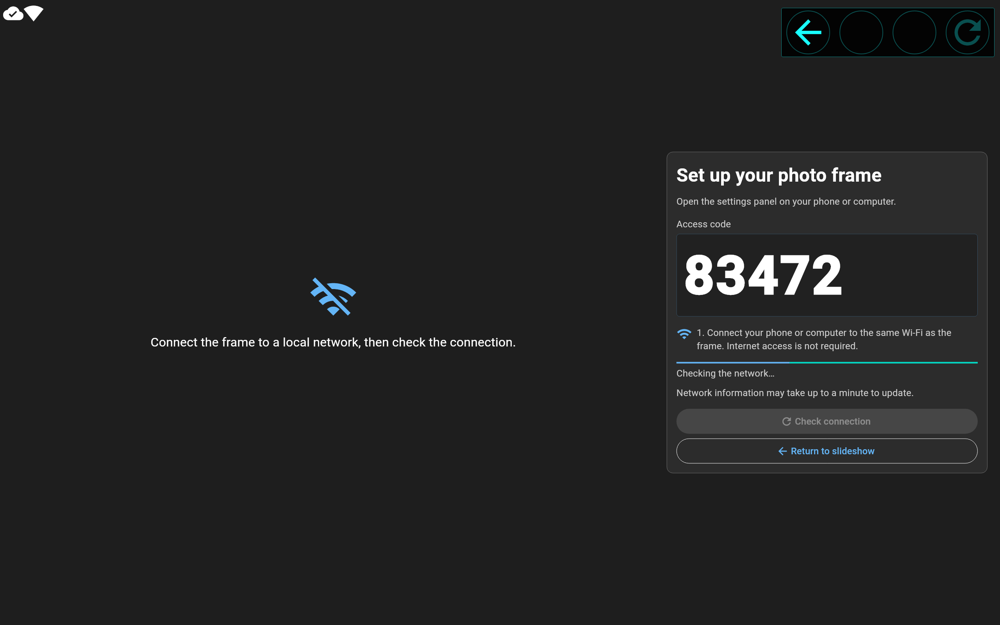
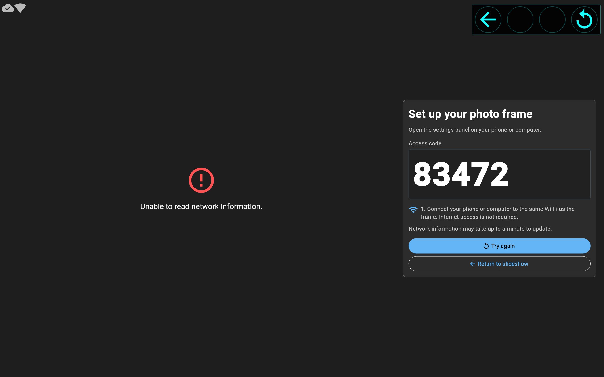
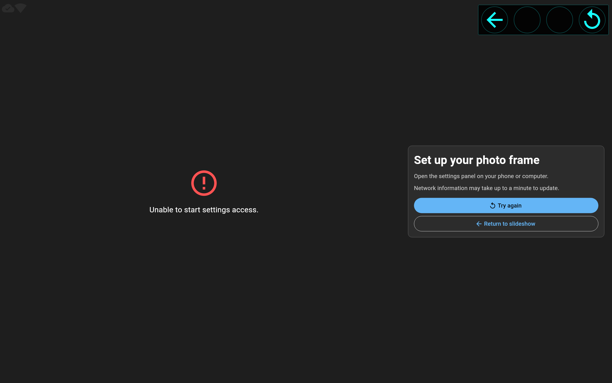
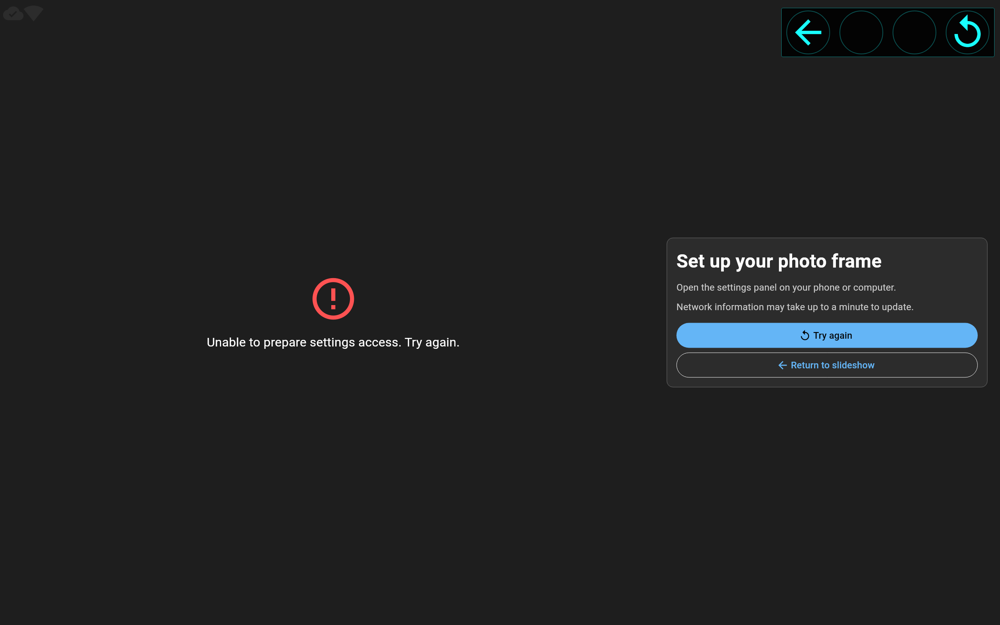
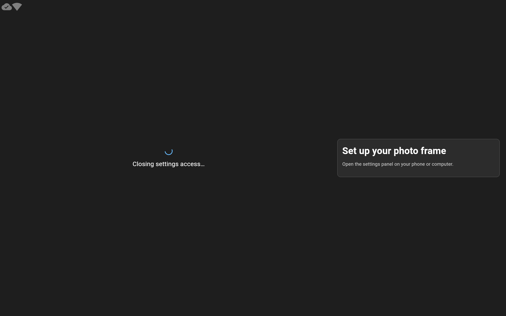
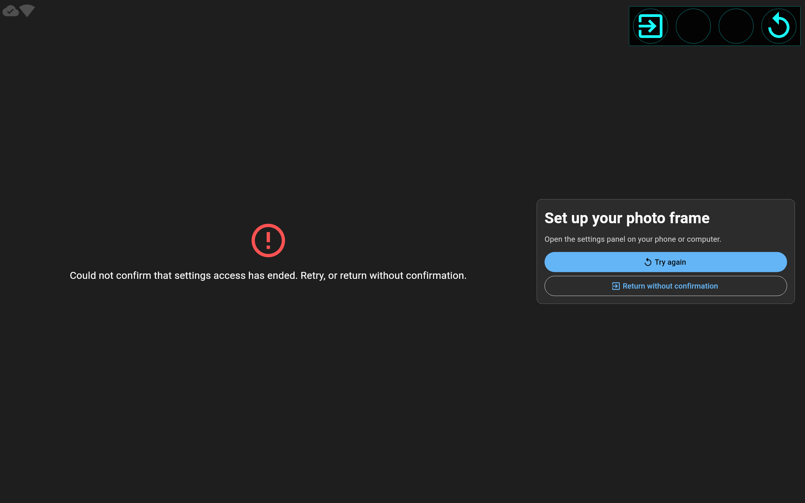
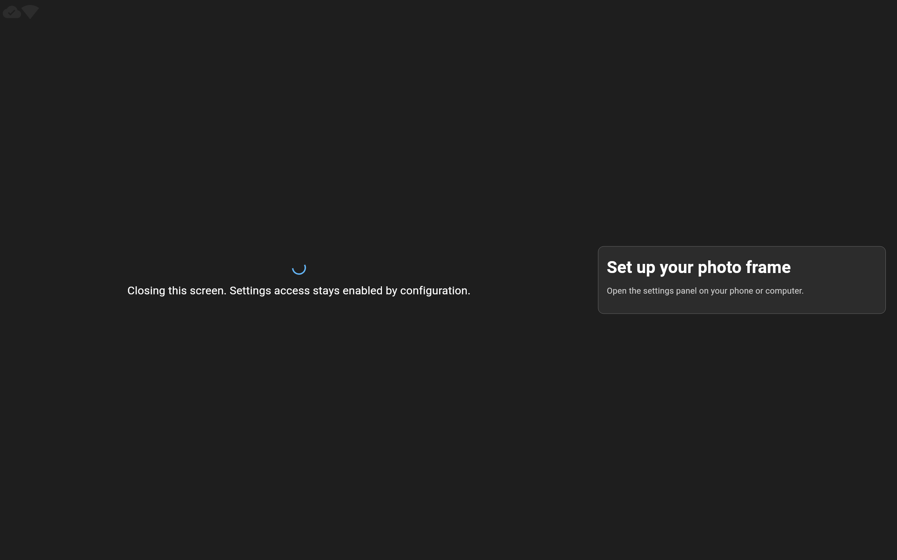

# Состояния экрана подключения к настройкам фоторамки

Актуальность: сверено с кодом **31.10.2026**. Экран **«Настройка фоторамки»**
открывает локальный доступ к [панели настройки](config-app.md): телефон или
компьютер подключается к той же сети, открывает QR/адрес и вводит код.
Телефон подключается к той же сети Wi-Fi, что и рамка; интернет для подключения не нужен.

Ниже показаны все фазы страницы и отдельные видимые варианты проверки,
ошибок. [Исторический обзор 17 снимков](images/config-page-states/overview.jpg)
также включает отменённые варианты таймаута RPC.
Это локальный рендер настоящих `ConfigPage`, `ConfigBloc` и QR-виджета на
2560×1600, DPR 1, `en`. Код `83472` и адрес — тестовые данные;
реальный web-сервер и приложение на рамке при захвате не запускаются.

## Подготовка и подключение

### 1. Подготовка доступа — `preparing`

Запуск HTTP-доступа и запрос системных данных выполняются параллельно.
Пока код не получен, рамка показывает название операции и индикатор.
QR и служебного значения вместо кода нет; возврат к слайдшоу доступен.
Ранний сетевой результат сохраняется до ответа запуска.



### 2. Код получен, адрес определяется — `preparingAddress`

Настоящий код появляется сразу после подтверждения запуска сервера.
Вместо QR остаётся индикатор определения адреса. Искусственной задержки нет.
Если оба результата уже получены, промежуточный кадр не обязателен.



### 3. Доступ готов — `ready`

Большой QR слева и карточка справа показывают код, последовательность
подключения, ручной адрес и действия. QR содержит только
`http://<IPv4>:<webServer.port>`: корень панели, без кода и без `/ota_start`.
Адрес можно выделить. Порт берётся из конфигурации, здесь это `8080`.


### 4. Проверка уже доступного адреса

«Проверить подключение» запрашивает системные данные без перезапуска сервера
и смены кода. QR и карточка сохраняются, появляется индикатор проверки;
повторное действие временно недоступно. Это вариант `ready`, а не новая фаза.


### 5. Подходящего адреса нет — `addressUnavailable`

При отсутствующем/пустом списке интерфейсов либо отсутствии `running`
интерфейса с непустым IPv4 вне `127.*` показана подсказка о локальной сети.
Вместо QR показан `wifi_off`, как на OTA. Прежний ручной адрес убирается.
Код сохраняется; доступны проверка и выход.
Выбирается первый подходящий интерфейс в порядке backend, без приоритета Wi-Fi.



Проверка из этого состояния также сохраняет карточку и показывает свою активность:



События `FrontendService.onSystemInfoUpdate` автоматически обновляют адрес,
убирают его при потере сети и восстанавливают при возвращении. Новое событие
приоритетнее старого ответа ручного запроса. Frontend получает события примерно
раз в минуту; ручная проверка учитывает минутный кеш сети backend и не обещает
мгновенного обнаружения изменения. Частого дополнительного polling нет.

## Ошибки — `failure`

### 6. Не удалось прочитать сведения о сети

Сбой RPC отличается от успешного ответа без интерфейса. Старый QR скрывается,
полученный код сохраняется. «Повторить» читает сеть, не запуская сервер заново.



### 7. Не удалось запустить доступ

Ошибка запуска имеет приоритет над готовым сетевым адресом. QR и код не
показываются. Повтор выполняет запуск доступа; уже полученные сетевые данные
могут использоваться после успешного ответа.



### 8. Неизвестная ошибка

Если отказ нельзя отнести к обычной ошибке операции, показано общее сообщение.
Сырое исключение и stack trace в интерфейс не попадают. Пустой код доступа
также считается ошибкой; повтор действительно делает новый запрос.



Запуск, чтение сети и завершение доступа используют надёжный межизолятный RPC:
каждая операция ждёт результат или ошибку без локального таймаута. До ответа
повтор той же операции недоступен. Успешный результат сразу применяется;
после ошибки доступен явный повтор.

## Завершение доступа

### 9. Завершение — `closing`

Код и адрес сразу скрываются. Владелец сессии последовательно освобождает
доступ; повторные нажатия игнорируются. Выход во время подготовки проходит
через ту же очистку: поздний успешный запуск не оставляет сервер включённым.



### 10. Ошибка завершения — `closeFailure`

Экран не утверждает, что сервер остановлен. Доступны повтор завершения и
явный возврат без подтверждения его результата. Подписки страницы всё равно
освобождаются; поздняя очистка старой страницы не отключает новый вход.



### 11. Сервер постоянно включён

При `webServer.alwaysEnabled=true` выход закрывает страницу, а HTTP-доступ
сохраняется по конфигурации. Это объясняется отдельным текстом `closing`.
Правила `permanentCode` и срок жизни кода не меняются.



### 12. Выход завершён — `exited`

Это техническая конечная фаза без отдельного экрана. `BlocListener` один раз
переключает маршрут на слайдшоу. Удаление страницы по внешней навигации также
отменяет подписки и передаёт освобождение доступа тому же владельцу сессии.
Закрытие Bloc ждёт локальные подписки; репозиторий сохраняет ответственность
за поставленную в очередь очистку. Последующие открытия используют ту же
очередь владения доступом и не отключаются очисткой старой страницы.

## Кнопки, оформление и архитектура

Вместо строки с номерами кнопок используется `ButtonsHintWidget` рядом с
физическими кнопками: координаты берутся из
`slideshow.buttons.hintOffsetX`/`hintOffsetY`, как в слайдшоу. Положение не
переносится автоматически при изменении окна: оно настроено под корпус рамки.
Четыре места сохраняются в порядке `button0…button3`; незадействованные места
пустые. Значки совпадают со значками экранных действий: стрелка назад,
обновление подключения, повтор и выход без подтверждения. Во время ожидания
недоступное действие приглушено, при `closing`/`exited` подсказка скрыта.
Контекстные подсказки остаются видимыми; удержание физической кнопки и короткая
подсветка после отпускания показывают её активность. Они не перехватывают
нажатия на экранные элементы под ними.


* Отпускание `button0` — возврат. В `closeFailure` это явный возврат без
  подтверждения; во время `closing` повторное нажатие игнорируется.
* Отпускание `button3` — проверка сети или повтор неудавшейся операции,
  когда действие доступно. `button1`/`button2` и события нажатия не выполняют
  эти команды. Экранные кнопки дублируют физические действия.
* На широком экране QR и карточка стоят рядом; при ширине меньше 1100 или
  высоте меньше 700 logical px используется вертикальная прокрутка.
  Заголовок рамки не перекрывает содержимое. Длинный постоянный код
  вписывается в свою область, адрес переносится, увеличенный текст
  не делает действия недоступными.
* Язык берётся из [настройки языка рамки](language.md), независимо от панели.
  `ConfigPage`, `ConfigView` и новые части интерфейса — `StatelessWidget`.
  Freezed-снимок хранит отдельные enum-статусы параллельных операций;
  `ConfigPhase` вычисляется из них. Операции и подписки принадлежат
  `ConfigBloc`; навигация остаётся в представлении, `BuildContext` в Bloc нет.
* `ConfigAccessRepository` — общий владелец очереди запуска/остановки для
  последовательных открытий. Проверка сети не создаёт новую сессию.
  Общие с OTA `AccessLayout` и `AccessQrCode` владеют только отображением.
  `ButtonsHintBloc.contextual` управляет только видимостью и подсветкой нажатия,
  не наследует действия кнопок слайдшоу. Его таймеры и подписка освобождаются
  вместе с подсказкой. В обычном слайдшоу сохраняются автоскрытие через пять
  секунд и постоянная подсказка открытого меню.
* `WebServerControlCommand` подтверждает фактическое завершение HTTP bind/close;
  отказ возвращается через обычную RPC-ошибку. Схема команды и ответа не меняется.
  Поле `enable` результата отражает запрос; `alwaysEnabled` имеет приоритет.
  Успешный bind не доказывает доступность адреса с телефона через firewall/сеть.

## Диагностика

`ConfigBloc` пишет INFO для начала/итога операции, выхода и очистки, WARNING
для отказа. Записи содержат действие и результат. Повторное выполнение
пока ожидается RPC блокирует существующее состояние `pending`, без отдельных
номеров операций и состояния неизвестного результата.
Отсутствие адреса и его восстановление
фиксируются при смене доступности, без журнала каждого опроса.

`WebService` пишет целевое состояние, начало, завершение и безопасный тип ошибки
перехода. По явному указанию пользователя от 30.10.2026
**код доступа выводится на INFO при обновлении кода, настройке постоянного
кода и успешном старте web-сервера**; этот риск принят для отладки рамки.
Исходные исключения и полный стек сохраняются по [общим правилам](logging.md);
текст ошибки, включая URL и реквизиты, не маскируется.

Уровень `WebService` задаёт `log.web`, уровень `ConfigBloc` — `log.main`.
На рамке смотреть общий журнал службы: `journalctl -u dslideshow -f`.
В локальном debug-запуске записи доступны в консоли приложения.

## Проверки и повторный захват

Из соответствующих пакетов, с заранее полученными зависимостями:

```sh
# backend/
dart analyze
dart test test/web_server_control_test.dart test/media_upload_test.dart test/gallery_http_test.dart

# dslideshow_flutter/
flutter analyze --no-pub
DSLIDESHOW_EMBEDDED=true flutter test --no-pub \
  test/config_bloc_test.dart test/config_access_session_test.dart \
  test/config_timeout_test.dart test/config_view_test.dart test/config_ready_paint_test.dart \
  test/buttons_hint_test.dart \
  test/ota_bloc_test.dart test/ota_view_test.dart test/ota_terminal_panel_test.dart \
  test/ota_ready_paint_test.dart test/frame_language_test.dart

# i18n/
flutter test --no-pub
```

VM-проверки используют рабочие Bloc/репозиторий/HTTP-сервер; fake заменяет
внешний frontend. Проверяются оба порядка подготовки, ошибки и повторы,
ожидание RPC без локального таймаута, события сети, внешнее закрытие, быстрый новый
вход, реальный bind/close, `alwaysEnabled`, диагностика и фактические пиксели.
Обычный layout — на `en`, переводы проверяются отдельно. При закрытии harness
ожидает завершение контроллеров в `tester.runAsync` до демонтажа provider.

Захват из `dslideshow_flutter/`:

```sh
DSLIDESHOW_EMBEDDED=true \
CONFIG_FLUTTER_ROOT=/home/dis/bin/flutter \
CONFIG_SCREENSHOT_DIR=build/config-screenshots \
flutter test --no-pub tool/capture_config_screenshots.dart --reporter expanded
```

Путь SDK замените для своего окружения. Команда сохраняет 12 PNG в каталоге
сборки; изображения руководства, обзорный лист и manifest не перезаписывает.
Сохранённый manifest относится к прежнему комплекту из 17 снимков, включая
удалённые варианты таймаута; он остаётся свидетельством того захвата.
Использованы Flutter 3.47.7 / Dart 3.13.5, локально загруженные из SDK
Roboto и Material Icons; тема harness явно выбирает Roboto вместо тестового Ahem.
[Manifest](images/config-page-states/manifest.json) содержит параметры,
исходный commit, перечень исходников и SHA-256. [Source patch](images/config-page-states/source.patch)
фиксирует изменения источников и захвата относительно указанного commit.

По указанию пользователя проверки этой работы **только локальные**.
Снимки и VM-тесты не подтверждают физическую читаемость дисплея, GPIO,
сетевую доступность с другого устройства, FrameTiming и ресурсы на RaPi5.
Установка DEB, запуск браузера и аппаратный прогон не выполнялись.
Результаты конкретного запуска хранятся в [истории локальных проверок](history/local-checks-2026-10.md#экран-подключения-к-настройкам-30102026).
