# Этапы обновления прошивки на экране фоторамки

Обновление проходит три основных этапа: **получение файла → установка →
перезапуск приложения**. Процент показывает только передачу файла: достижение
100% ещё не означает завершения обновления. Во время получения, установки
и перезапуска рамка напоминает не отключать питание.

Ниже показаны все 13 сохранённых состояний интерфейса: основной сценарий,
отсутствие сетевого адреса и ошибки. [Общий лист всех экранов](images/ota-update-stages/overview.jpg).
Скриншоты обновлены локально 30.10.2026 в разрешении 2560×1600, DPR 1,
с английским языком интерфейса. Код доступа, адрес и вывод установщика —
тестовые данные. Реальная установка пакета и перезапуск при захвате не выполнялись.

## Основной сценарий

### 1. Подготовка страницы обновления

Рамка показывает текущую версию и индикатор подготовки. Код доступа и QR-код
ещё не получены, поэтому на этом экране их нет.

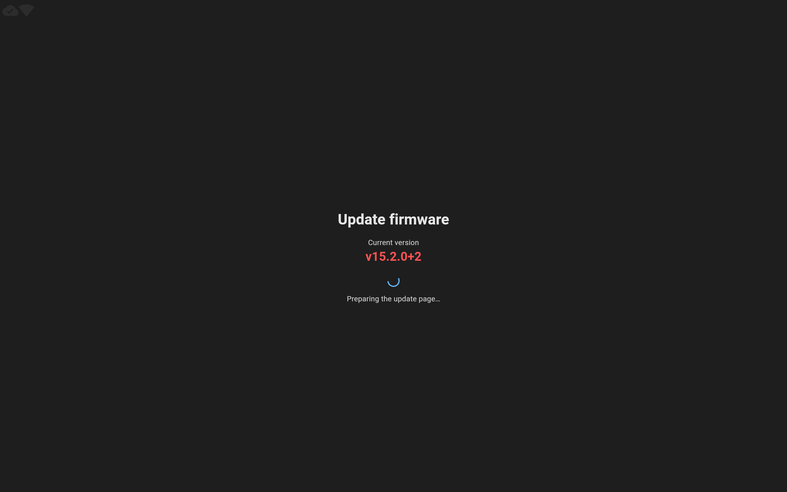

### 2. Ожидание сетевого адреса

Рамка уже получила код доступа. Пока определяется адрес страницы обновления,
на месте QR-кода остаётся сообщение подготовки.

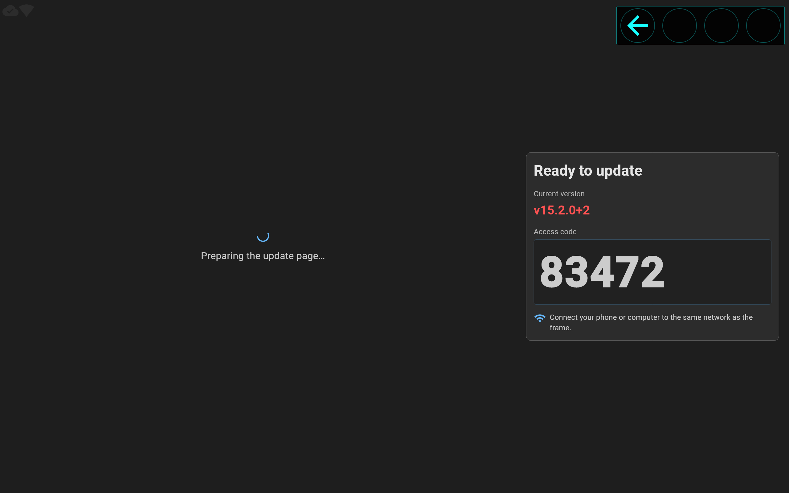

### 3. Готовность к обновлению

На экране видны большой QR-код страницы OTA, адрес для ручного открытия,
код доступа и текущая версия. Телефон или компьютер для загрузки прошивки
нужно подключить к той же сети, что и рамку.

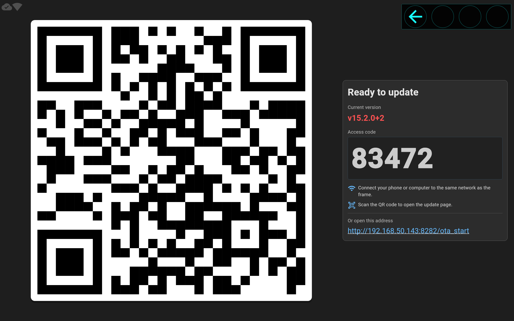

### 4. Начало получения файла — 0%

Голубая стрелка вниз обозначает получение прошивки на рамку. Выделен первый
шаг, справа показан процент передачи, под ним — полоса прогресса.
Пока установщик не начал вывод, область журнала объясняет, когда он появится.

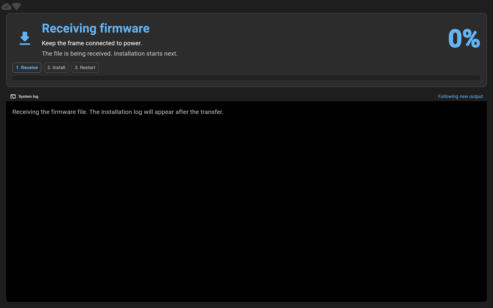

### 5. Получение файла — 67%

Процент и полоса отражают ход передачи файла. Установка и перезапуск
показаны как следующие шаги; рамка продолжает напоминать о питании.

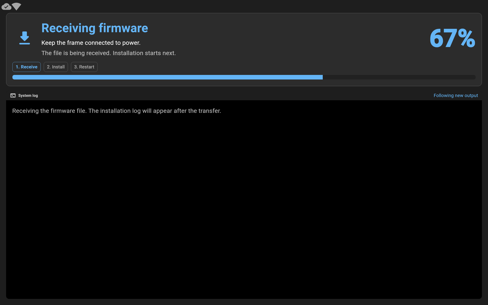

### 6. Передача файла завершена — 100%

Файл передан полностью, но установка ещё не началась. Первый шаг остаётся
активным до получения следующего статуса. Значение `100%` помещается в одну
строку и не сдвигает заголовок, полосу или журнал.

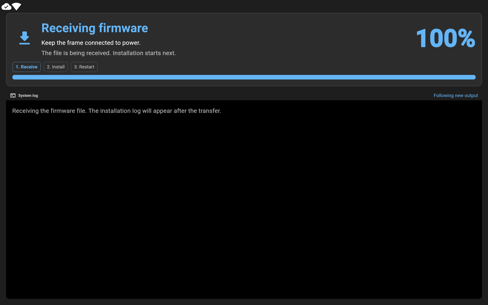

### 7. Установка прошивки

Шестерёнка и выделенный второй шаг обозначают установку. Вместо процента
показан индикатор активности: точный процент установки неизвестен.
В терминале появляется вывод установщика. При первом видимом тексте подсказка
пустого журнала исчезает, история сохраняется.

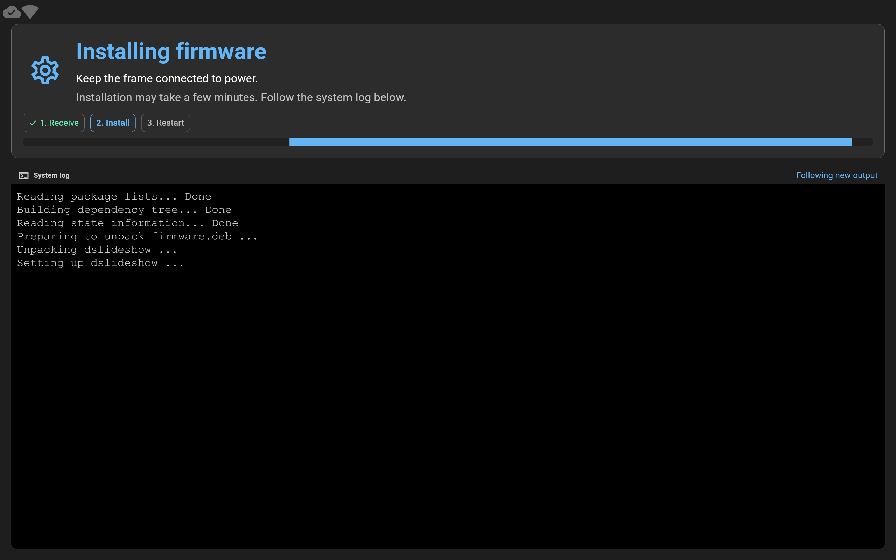

### 8. Установка завершена

Зелёная галочка и заголовок `Firmware installed` подтверждают успешную
установку. Первые два шага отмечены выполненными; приложение ожидает
перезапуска. Пользователь ждёт: возврат и подсказки кнопок недоступны.
Журнал остаётся доступным.

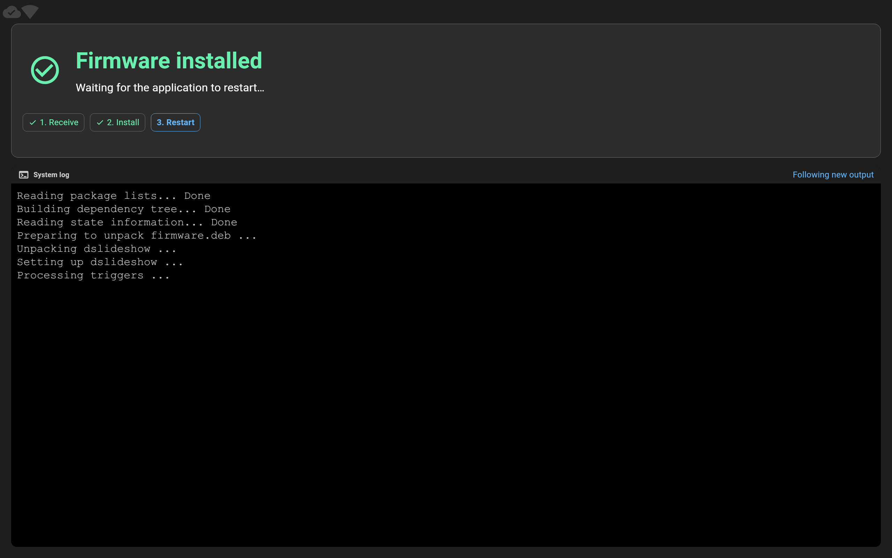

### 9. Перезапуск приложения

Голубая круговая стрелка и заголовок `Restarting the application` обозначают
начало перезапуска. Активен третий шаг. Экран отличается от завершения установки
и сохраняет напоминание о питании. Возврат и подсказки кнопок недоступны;
нужно дождаться перезапуска.

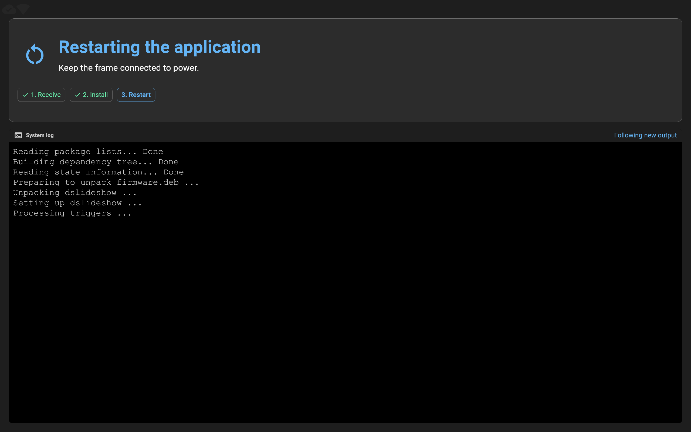

### 10. Закрытие экрана обновления

Перед закрытием показан статус `Closing the update screen…`. До удаления
страницы журнал сохраняется. Закрытие экрана само по себе не отменяет уже
начатую передачу файла или установку.

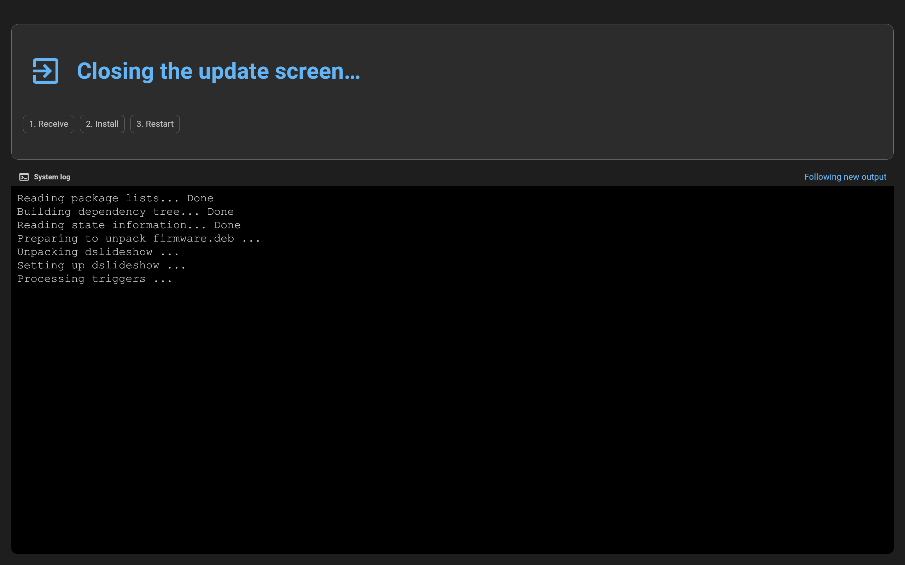

## Отсутствие сети и ошибки

Эти состояния представляют отдельные ветки, а не обязательные шаги успешного
обновления.

### Сетевой адрес недоступен

QR-код не показывается, если рамка не смогла определить пригодный сетевой
адрес. На экране остаются код доступа, версия и сообщение о необходимости
подключить рамку к сети.

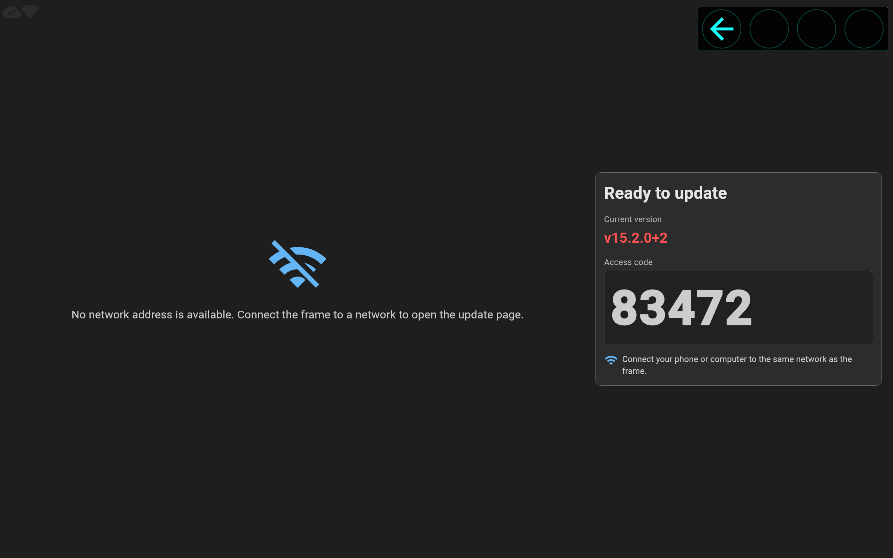

### Ошибка с известной причиной

Красный значок и заголовок `Update failed` сопровождаются причиной отказа.
Журнал сохраняет подробности. Подсказка рядом с физическими кнопками
показывает стрелку возврата к слайдшоу; автоматический откат или повторная установка не выполняются.

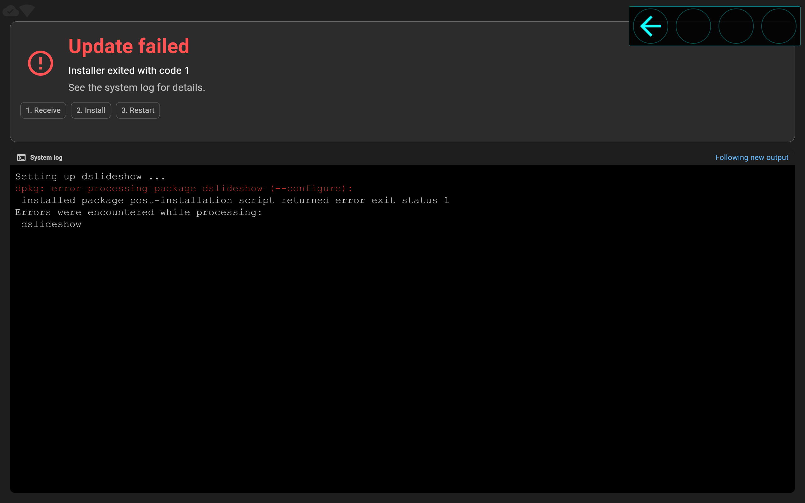

### Ошибка без описания

Если причина не передана, рамка показывает `An unknown error occurred.`
Журнал и подсказка возврата остаются доступными.


## Подсказки физических кнопок

`ButtonsHintWidget` выводится по `slideshow.buttons.hintOffsetX`/`hintOffsetY`
рядом с кнопками корпуса, в том же положении, что на экране настройки и в
слайдшоу. Только в готовности и при ошибке первая позиция показывает стрелку
возврата; остальные три пусты. Обработчик принимает `button0` только в этих
состояниях. При подготовке, передаче, установке, успешном завершении,
подготовке к перезапуску и закрытии подсказка отсутствует.
После успешной установки (`finished`) и при `preReboot` любые попытки возврата
не меняют маршрут: пользователь должен дождаться автоматического перезапуска.
Текст с указанием нажать Back заменён этой физической подсказкой.
Контекстные значки не исчезают по таймеру; нажатая кнопка подсвечивается.

## Поведение карточки и журнала

На экране 2560×1600 карточка статуса имеет высоту 384 logical px, иконка этапа —
96 px в области 128×128. Под полосой оставлен обычный отступ; остальную высоту
занимает терминал. Положение журнала не меняется при переходе между получением,
установкой, завершением и ошибкой. На небольшом экране карточка ограничена 45%
доступной области, её содержимое можно прокручивать.

Журнал использует шрифт 32 logical px и автоматически следует за новыми строками.
Прокрутка вверх приостанавливает слежение; кнопка «К последней строке» или ручной
возврат вниз возобновляет его. Управляющие ANSI-фрагменты без видимого текста
не скрывают пояснение пустого журнала.

## Происхождение снимков и повторный захват

Снимки показывают настоящие `MainApp → OTAPage → OTAView`, `OtaBloc`
и `TerminalView` с тестовыми событиями внешнего frontend. Использованы
Flutter 3.47.7 / Dart 3.13.5, embedded-режим без кнопок разработчика.
Для локального рендера загружены Roboto и Material Icons из SDK; локальный
Courier New зарегистрирован также под именем Cascadia Mono. Это настройка
захвата, а не изменение выбора шрифтов приложения на устройстве.

[Manifest](images/ota-update-stages/manifest.json) содержит параметры захвата,
исходный commit и SHA-256 файлов. [Source patch](images/ota-update-stages/source.patch)
сохраняет изменения production-исходников той сборки относительно указанного
commit. Снимки относятся к зафиксированной сборке; номер версии на них не
меняется при последующих выпусках.

Для нового локального захвата выполните из `dslideshow_flutter/`:

```sh
DSLIDESHOW_EMBEDDED=true \
OTA_FLUTTER_ROOT=/home/dis/bin/flutter \
OTA_TERMINAL_FONT=/usr/share/fonts/truetype/msttcorefonts/Courier_New.ttf \
OTA_SCREENSHOT_DIR=build/ota-screenshots \
flutter test --no-pub tool/capture_ota_screenshots.dart --reporter expanded
```

Пути SDK и моноширинного TTF замените для своего окружения. Команда сохраняет
13 PNG в отдельном каталоге сборки; изображения этого руководства, общий лист
и manifest она не перезаписывает. Проверки выполняются локально и не запускают
браузер, установщик или приложение на рамке. Они не подтверждают плавность
анимации, выбор шрифтов и читаемость на физическом дисплее.

Связанные материалы: [контракт OTA и загрузок](uploads.md#терминал-на-экране-рамки),
[терминал OTA и локальные тесты](../dslideshow_flutter/README.md#терминал-ota).
